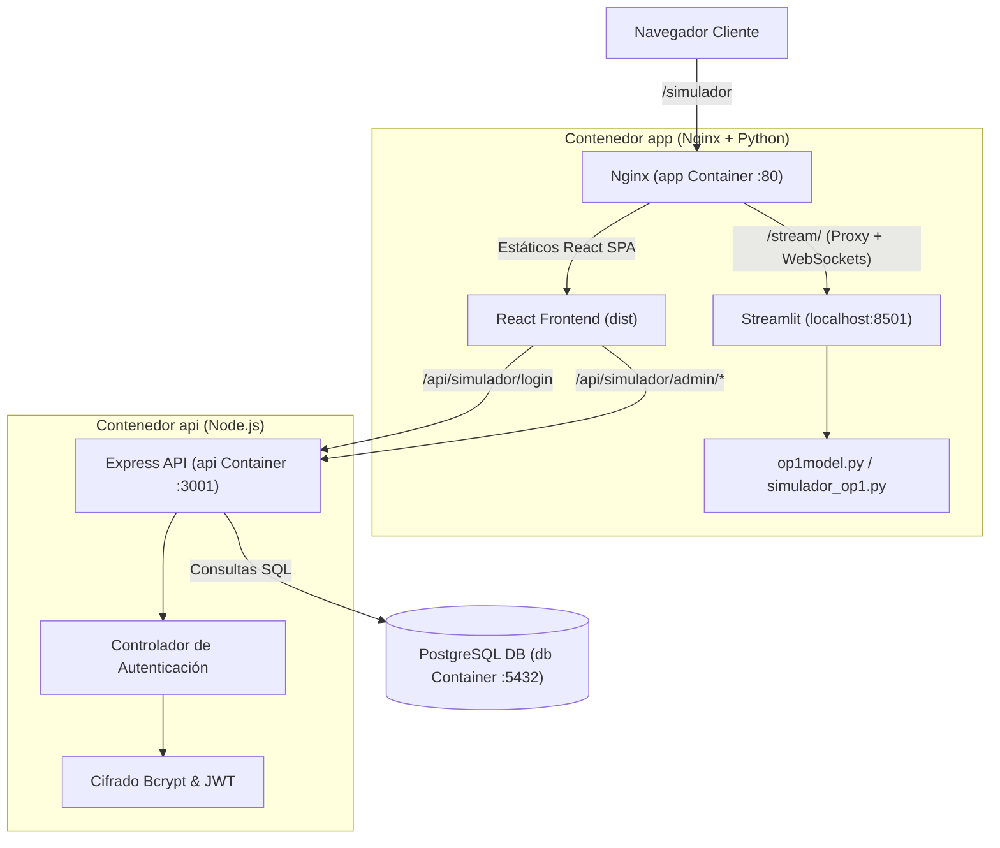

# Especificación de Diseño: Integración Privada del Simulador OP1 con Panel de Administración

- **Fecha:** 2026-10-30
- **Estado:** Aprobado
- **Módulo:** Simulador Financiero OP1 & Gestión de Accesos

---

## 1. Resumen Ejecutivo

Integrar el simulador paramétrico del modelo financiero OP1 (`op1_web/`) dentro de la plataforma web existente de Akredita Me. El acceso se realizará exclusivamente mediante una ruta privada no referenciada en la navegación pública (`/simulador`). La visualización requerirá autenticación mediante correo y contraseña. Existirá una interfaz maestra de administración protegida para dar de alta, consultar, activar/desactivar y eliminar credenciales de usuarios. Toda la solución del frontend y del simulador se empaqueta de forma embebida dentro del contenedor existente de `app` (Nginx + Python/Streamlit), sin requerir servicios adicionales ni Dockerfiles extra.

---

## 2. Requerimientos y Casos de Uso

### 2.1 Acceso y Enrutamiento Discreto
- **Ruta dedicada:** `https://<dominio>/simulador`.
- **Cero referencias públicas:** Ni el `Navbar`, ni el `Footer`, ni ninguna sección de la landing page pública contendrá enlaces, botones o rastros visibles hacia `/simulador`.
- **Fallback SPA:** La configuración del servidor web (Nginx) y del router en cliente debe resolver `/simulador` directamente sin errores 404 al refrescar la página.

### 2.2 Autenticación y Control de Sesión
- Al ingresar a `/simulador` sin sesión activa, se presentará un formulario de inicio de sesión institucional con la identidad gráfica de Akredita Me.
- Campos requeridos: **Correo electrónico** y **Contraseña**.
- Validación contra la base de datos PostgreSQL mediante endpoint seguro en `api`.
- Emisión de token JWT con tiempo de expiración configurable (por defecto 24 horas) almacenado en `sessionStorage` / `localStorage`.
- Posibilidad de cerrar sesión en cualquier momento mediante un botón visible en la barra superior del simulador.

### 2.3 Roles y Privilegios
- **Usuario Estándar (`user`):** Tiene acceso de lectura e interacción con el simulador de Streamlit tras iniciar sesión.
- **Administrador Maestro (`admin`):** Además de interactuar con el simulador, tiene acceso exclusivo a la **Interfaz Maestra de Gestión de Usuarios**.

### 2.4 Interfaz Maestra de Gestión de Usuarios
- Accesible únicamente para usuarios con rol `admin`.
- Presenta un panel o modal con:
  1. **Listado de accesos autorizados:** Correo, nombre/referencia, fecha de alta y estado (Activo / Inactivo).
  2. **Formulario de alta:** Registro de nuevo usuario (Correo, Nombre/Referencia, Contraseña inicial).
  3. **Acciones de control:**
     - Activar / suspender acceso con un clic.
     - Actualizar contraseña.
     - Eliminar usuario.

---

## 3. Arquitectura del Sistema



---

## 4. Detalle de Componentes

### 4.1 Frontend (`app/src/`)
1. **Detección de Ruta y Vistas (`App.jsx`):**
   - Evalúa `window.location.pathname === '/simulador'`.
   - Si no coincide con `/simulador`, renderiza la landing page pública habitual (Navbar, Hero, Pillars, ValueProp, Trust, Contact, Footer).
   - Si coincide con `/simulador`, renderiza el componente `SimulatorContainer`.

2. **`SimulatorContainer.jsx`:**
   - Comprueba el estado de autenticación (token en almacenamiento local y verificación vía `/api/simulador/verify`).
   - Si no está autenticado: renderiza `SimulatorLogin`.
   - Si está autenticado: renderiza una barra de control superior (Logo Akredita Me, correo del usuario, botón "Administración" si es admin, y botón "Cerrar sesión") y debajo el `iframe` apuntando a `/stream/?embed=true`.

3. **`SimulatorLogin.jsx`:**
   - Tarjeta centrada con logotipo de Akredita Me, paleta institucional (Navy, Gold, White).
   - Inputs para Correo Electrónico y Contraseña con validaciones.
   - Manejo de estados de carga y mensajes de error ("Credenciales no válidas").

4. **`SimulatorAdminModal.jsx`:**
   - Modal o vista emergente para administradores.
   - Tabla interactiva con búsqueda/filtros de usuarios.
   - Formulario para dar de alta nuevos usuarios con validación de correo y contraseña.
   - Acciones inmediatas para cambiar estado o resetear contraseñas.

### 4.2 Backend (`api/`)
1. **Modelo de Base de Datos (`api/db/init.sql`):**
   ```sql
   CREATE TABLE IF NOT EXISTS simulator_users (
       id UUID PRIMARY KEY DEFAULT uuid_generate_v4(),
       email VARCHAR(255) UNIQUE NOT NULL,
       password_hash VARCHAR(255) NOT NULL,
       name VARCHAR(255),
       role VARCHAR(50) DEFAULT 'user',
       is_active BOOLEAN DEFAULT TRUE,
       created_at TIMESTAMP WITH TIME ZONE DEFAULT CURRENT_TIMESTAMP,
       updated_at TIMESTAMP WITH TIME ZONE DEFAULT CURRENT_TIMESTAMP
   );
   ```

2. **Semilla Inicial (Admin por defecto):**
   - Script o lógica de arranque que inserta el usuario administrador si la tabla está vacía, usando las credenciales predefinidas o variables de entorno:
     - `SIMULATOR_ADMIN_EMAIL`: `roberto.martinez@akredita.me`
     - `SIMULATOR_ADMIN_PASSWORD`: `Temporal12345!!`
     - `name`: `Roberto Martinez`
     - `role`: `admin`

3. **Endpoints de la API (`api/index.js` o rutas modulares):**
   - `POST /api/simulador/login`: Valida email y password con `bcrypt.compare`. Retorna JWT firmado con `{ id, email, role }`.
   - `GET /api/simulador/verify`: Middleware que verifica el token JWT y responde con el estado de la sesión.
   - `GET /api/simulador/admin/users`: Retorna la lista de usuarios (sin incluir `password_hash`).
   - `POST /api/simulador/admin/users`: Registra un nuevo usuario con contraseña cifrada (`bcrypt.hash`).
   - `PATCH /api/simulador/admin/users/:id`: Modifica estado (`is_active`), nombre o contraseña.
   - `DELETE /api/simulador/admin/users/:id`: Elimina un usuario (impidiendo que el admin se autoelimine).

### 4.3 Empaquetado Embebido (`app/Dockerfile`)
Para cumplir la directiva de no crear nuevos Dockerfiles ni nuevos servicios en docker-compose:
- Se adapta `app/Dockerfile`:
  1. **Build Stage:** `node:20-alpine` compila la aplicación React con Vite.
  2. **Production Stage:** Imagen base con Nginx y Python 3 (`python:3.13-slim` con Nginx instalado, o `nginx:alpine` con Python3 y pip instalados).
  3. **Instalación de Dependencias Python:** Copia `op1_web/requirements.txt` y corre `pip install --no-cache-dir -r requirements.txt`.
  4. **Copia de Archivos:**
     - Copia `./dist` a `/usr/share/nginx/html`.
     - Copia `./op1_web` a `/opt/simulador`.
  5. **Configuración de Nginx (`app/nginx.conf`):**
     - SPA Fallback: `try_files $uri $uri/ /index.html;`.
     - Reverse Proxy para Streamlit:
       ```nginx
       location /stream/ {
           proxy_pass http://127.0.0.1:8501/;
           proxy_http_version 1.1;
           proxy_set_header Upgrade $http_upgrade;
           proxy_set_header Connection "upgrade";
           proxy_set_header Host $host;
           proxy_read_timeout 86400;
       }
       ```
  6. **Script de Entrada (`entrypoint.sh`):**
     - Inicia Streamlit: `streamlit run /opt/simulador/simulador_op1.py --server.port=8501 --server.address=127.0.0.1 --server.baseUrlPath=stream &`
     - Inicia Nginx en primer plano: `nginx -g 'daemon off;'`.

---

## 5. Variables de Entorno y Seguridad

- `JWT_SECRET`: Clave privada para firma de tokens de sesión del simulador.
- `SIMULATOR_ADMIN_EMAIL`: Correo inicial del administrador maestro.
- `SIMULATOR_ADMIN_PASSWORD`: Contraseña inicial del administrador maestro.
- `OP1_AUTH_EXTERNA=1`: Para suprimir advertencias internas de Streamlit, garantizando que toda la seguridad se gobierna desde la plataforma Akredita Me.

---

## 6. Estrategia de Pruebas y Verificación

1. **Prueba de Enrutamiento y Navegación:**
   - Cargar `http://localhost:5173/` (o puerto de app): verificar que no existe ningún enlace visible a `/simulador`.
   - Navegar a `http://localhost:5173/simulador`: verificar que se muestra la pantalla de login institucional.
2. **Prueba de Autenticación:**
   - Intentar login con credenciales erróneas: verificar mensaje de rechazo.
   - Login con credenciales de usuario estándar: verificar acceso inmediato al iframe del simulador sin opciones de administración.
3. **Prueba de Panel de Administración:**
   - Login con credenciales de administrador: verificar botón de "Administración de Usuarios".
   - Crear un nuevo usuario inversionista desde la interfaz maestra.
   - Probar inicio de sesión con el nuevo usuario creado.
   - Probar desactivar el usuario desde el panel y confirmar que ya no puede ingresar.
4. **Prueba del Simulador:**
   - Verificar la interacción completa de las pestañas financieras y cálculos de `simulador_op1.py` dentro del iframe.
5. **Prueba de Contenedor:**
   - Construcción y ejecución del contenedor `app` unificado para confirmar que Nginx y Streamlit operan en armonía.

